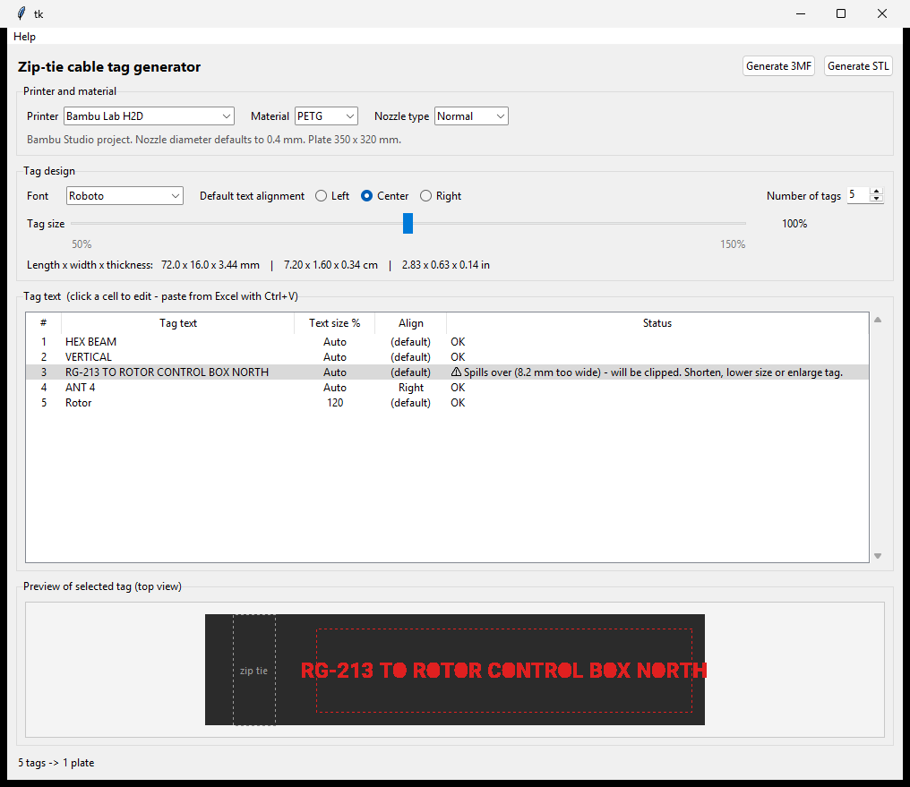

# Ziptie Tags

Windows desktop app that generates **zip-tie cable tag 3MF files**: a black tag body with the text
inlaid flush in orange, ready for Bambu Studio (or any slicer via a plain 3MF).



## Features

- 1–40 tags, entered in a spreadsheet-style table (paste straight from Excel)
- Per-tag text size (blank = auto-fit) with a warning when text spills over the tag, per-tag alignment
- 10 embedded open-licensed fonts (Roboto, Open Sans, Lato, Montserrat, Oswald, Source Sans 3,
  Noto Sans, Roboto Condensed, Poppins, Inter)
- Tag size slider 50 %–150 % with dimensions in mm, cm and inches; thickness (3.44 mm) and the 6 × 2 mm
  zip-tie slot never change
- Material PLA / PETG / ABS, Normal or High Flow nozzle (H2D / H2C)
- Printers: Bambu Lab A1, X1, P1S, P1P, H2C, H2D (native Bambu Studio projects), or **Other printer**
  (plain 3MF without any Bambu Studio header or settings)
- Automatic multi-plate layout, with room kept for the prime tower and printer dead zones
- **Generate 3MF** and **Generate STL** buttons (STL = geometry only, for CAD or any slicer), each using the
  standard Save As dialog

Nozzle diameter defaults to **0.4 mm**. Layer plan: 0.20 mm body, top 0.64 mm (the text) at 0.08 mm.

## Run from source

```powershell
python -m pip install -r requirements.txt
python ziptie_tags.py
```

## Build the .exe

```powershell
powershell -ExecutionPolicy Bypass -File build.ps1   # lint + tests + PyInstaller -> dist\ZiptieTags.exe
```

## Develop

```powershell
python -m pip install -r requirements-dev.txt
python -m ruff check .
python -m pytest -q
python ziptie_tags.py --selftest out.3mf       # builds a project without opening the window
```

See [CLAUDE.md](CLAUDE.md) for architecture and conventions, [CHANGELOG.md](CHANGELOG.md) for releases and
[docs/SPEC.md](docs/SPEC.md) for the original spec and test plan.

## Notes

- Bambu projects are built from settings templates in `templates/`; regenerate them with
  `tools/make_templates.py` (needs Bambu Studio installed plus two Studio-saved reference projects).
- `tools/slice_check.py` validates a generated file with the Bambu Studio CLI. **Close Bambu Studio first**;
  a failing CLI run can pop an "out of memory" dialog.
- Not every printer/material/nozzle combination has been test-printed. Review the project in your
  slicer before printing.

## License

GPL-3.0, see [LICENSE](LICENSE). Bundled fonts are under the SIL Open Font License (`fonts/OFL-*.txt`).
